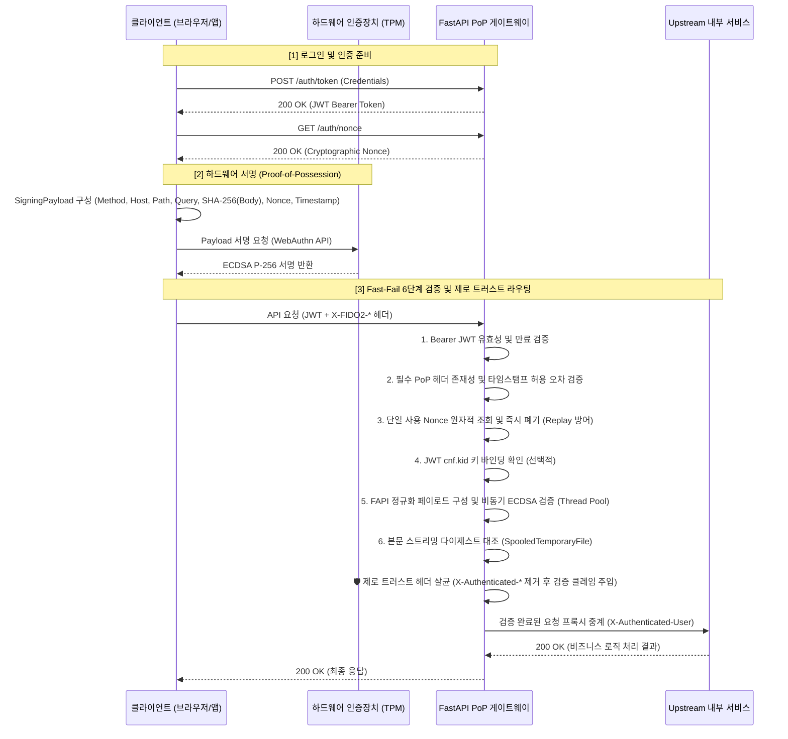

# FIDO2 Proof-of-Possession (PoP) 게이트웨이

## 1. 프로젝트 개요

### 연구 배경

**RFC 6750 Bearer 토큰**은 인증 흐름을 단순화하는 데 효과적이지만, 토큰이 탈취되면(XSS, 브라우저 익스텐션 취약점, 인포스틸러 악성코드 등) 공격자가 제약 없이 재사용할 수 있다는 구조적 한계가 있습니다.

이를 보완하기 위해 애플리케이션 수준의 키 바인딩 기술인 **DPoP (RFC 9449)**이 등장했습니다. 그러나 DPoP도 소프트웨어 기반 키를 사용하므로, 메모리 덤프나 파일 시스템 접근을 통한 개인키 유출 위험을 근본적으로 해소하지 못합니다.

### 연구 목표

본 프로젝트는 **FIDO2/WebAuthn의 하드웨어 격리 키(TPM, Secure Enclave, YubiKey 등)**를 바인딩하여, 세션 하이재킹과 토큰 탈취 공격을 구조적으로 방어하는 경량 L7 리버스 프록시 게이트웨이를 구현하고 정량적 성능 타당성을 검증합니다.

---

## 2. 전체 시스템 흐름 및 아키텍처

클라이언트는 HTTP 요청 컨텍스트를 하드웨어 개인키로 서명하여 전송하고, 게이트웨이는 이를 검증한 뒤 내부 서비스(Upstream)로 중계합니다.



### 고부하 및 엔터프라이즈(FAPI) 보안 아키텍처 고도화

실제 상용(Production) 수준의 동시성 방어 및 금융권 보안 표준(FAPI)을 충족하도록 아키텍처가 전면 최적화되었습니다:

1. **비동기 논블로킹(Non-blocking) 서명 검증**: 
   - 타원곡선(ECDSA P-256) 검증과 같은 CPU 집약적 연산이 `asyncio` 이벤트 루프를 차단(Block)하지 않도록, `anyio.to_thread`를 활용한 작업자 스레드 풀(Thread Pool) 위임 구조로 설계되었습니다.
   - OpenSSL C-확장 모듈이 연산 도중 Python GIL(Global Interpreter Lock)을 해제하여, 단일 프로세스에서도 멀티코어 병렬 검증을 실현하였습니다.
2. **O(1) 인그레스 Rate Limiter 및 메모리 위생(Active Hygiene)**: 
   - IP 기반 초당 10회 요청 제한 로직이 `collections.deque.popleft()` (O(1))로 구현되어, 고부하 환경에서의 Thread Lock 경합(Contention) 시간을 상수로 단축시켰습니다.
   - 최대 추적 IP 수(`max_tracked_ips=10000`) 제한 및 30초 주기 백그라운드 GC 태스크(`gc_task`)를 통해 휴면 IP와 만료 Nonce를 자동 해제하여 메모리 누수를 원천 차단합니다.
3. **FAPI 등급 정규화 페이로드 바인딩 (Query String 검증)**: 
   - 서명 원문($SigningPayload$)에 HTTP Method, Host, Path뿐만 아니라 **Query Parameter를 포함**하여, 공격자가 전송 금액(`?amount=`) 등을 위조해 재전송하는 악의적 파라미터 변조 공격을 원천 차단합니다.
4. **Zero-Trust 인바운드 헤더 살균(Header Sanitization)**: 
   - 프록시 중계 전 클라이언트가 임의로 전송한 `X-Authenticated-*`, `X-Forwarded-User`, `Host` 헤더를 강제 파기(Drop)하고, 게이트웨이가 검증한 신원(`X-Authenticated-User`, `X-Authenticated-Role`)만을 주입하여 내부 서비스의 권한 상승 공격을 방지합니다.
5. **임계치 기반 스트리밍 버퍼 (`SpooledTemporaryFile`)**:
   - 1MB(`spooled_body_max_size_bytes`) 이하는 초고속 메모리 버퍼에서 처리하고 초과 시 디스크 스왑 파일로 자동 전환하여, 대용량 페이로드에 의한 메모리 고갈(DoS)을 방지함과 동시에 단일 순회 스트리밍 검증과 프록시 중계를 결합하였습니다.

---

## 3. 실측 벤치마크 및 모의 공격 결과 분석

### 모의 공격 시뮬레이션 결과 (`benchmarks/simulate_attack.py`)

| 공격 시나리오 | 인입 패킷 및 변조 조건 | 응답 코드 | 방어 판정 | 세부 차단 메커니즘 |
|---|---|---|---|---|
| **1. Baseline (정상 요청)** | 유효한 JWT + FIDO2 하드웨어 서명 | **200 OK** | **PASS** | 6단계 검증 통과 후 업스트림 정상 중계 |
| **2. Session Hijacking** | 탈취한 JWT만 단독 전송 (서명 누락) | **401 Unauthorized** | **PASS** | 2단계 (필수 PoP 서명 헤더 누락 즉시 차단) |
| **3. Replay Attack** | 스니핑 패킷 그대로 재전송 (기사용 Nonce) | **401 Unauthorized** | **PASS** | 3단계 (단일 사용 Nonce 원자적 조회 실패) |
| **4. Body 변조 (단순 변조)** | 유효한 서명 헤더 + 실제 본문 데이터 조작 | **400 Bad Request** | **PASS** | 6단계 (스트리밍 본문 해시 대조 불일치) |
| **4b. 고도화된 Body 변조** | 본문 변조 후 조작된 `X-Body-Digest` 전송 | **403 Forbidden** | **PASS** | 5단계 (선언 다이제스트와 하드웨어 서명 불일치) |
| **5. Path/Method 변조** | 인가 경로(`/resource`) 서명 후 `/admin` 요청 | **403 Forbidden** | **PASS** | 5단계 (정규화 페이로드와 하드웨어 서명 불일치) |
| **헤더 인젝션 방어** | 클라이언트의 악의적 `X-Authenticated-Admin` 주입 | **200 OK** | **PASS** | 제로 트러스트 살균 (비인가 헤더 강제 파기 확인) |

### 정량적 성능 및 페이로드 지표 (`benchmarks/benchmark_latency.py`)

100회 반복 측정 기준 지연 시간(Latency)과 HTTP 헤더 오버헤드 실측값입니다 (`docs/benchmark_results.json`).

| 검증 모드 | Mean (평균 지연) | P95 (95백분위 지연) | Payload (헤더 크기) | Digest 헤더 | 상대 오버헤드 |
|---|---|---|---|---|---|
| **Mode A (표준 JWT 검증)** | **2.66 ms** | **2.95 ms** | 0 Bytes | 0 Bytes | 기준 (Baseline) |
| **Mode B (RSA-2048 PoP)** | **4.42 ms** | **5.75 ms** | 499 Bytes | 84 Bytes | **+65.99%** |
| **Mode C (ECDSA P-256 PoP)** | **4.67 ms** | **6.25 ms** | 243 Bytes | 84 Bytes | **+75.52%** |

**기술적 함의 및 하드웨어 시사점**:

1. **지연시간 타당성**: ECDSA P-256(Mode C)은 표준 JWT 검증 대비 절대 지연시간 증가폭이 **2.01 ms**에 불과하며, 꼬리 지연시간(P95) 역시 **6.25 ms**로 10 ms 미만의 안정적인 응답 분포를 유지합니다.
2. **페이로드 크기 (RSA vs ECDSA)**: RSA-2048 서명은 256바이트이며 Base64 인코딩 후 499바이트의 헤더 오버헤드를 유발합니다. ECDSA P-256 서명은 64바이트(IEEE P1363 $(r, s)$ 좌표)로, 동일한 보안 강도를 유지하면서 헤더 오버헤드를 **약 51.3% 절감(243 Bytes)**합니다.
3. **제한된 하드웨어(Constrained Hardware) 환경**: TPM, Secure Enclave, YubiKey와 같은 임베디드 보안 칩셋은 연산 자원과 대역폭이 제한적입니다. 이러한 환경에서 ECDSA P-256은 작은 키·서명 크기와 높은 연산 효율 덕분에 실무 하드웨어 바인딩의 글로벌 표준으로 적합합니다.

---

## 4. 실시간 웹 대시보드 (Interactive Dashboard)

본 프로젝트는 시스템의 보안성 및 성능 최적화 결과를 직관적으로 증명하기 위해 **React + Vite 기반의 실시간 시각화 대시보드(`frontend/`)**를 제공합니다.

> 🌐 **Live Demo (GitHub Pages):** [https://altdmfk.github.io/fido2-pop-gateway/](https://altdmfk.github.io/fido2-pop-gateway/)

1. **아키텍처 및 공격 시뮬레이터 (Attack Simulator)**
   - **5가지 시나리오 모의**: `정상 요청`, `세션 하이재킹`, `재전송 공격`, `페이로드 변조`, `헤더 인젝션` 상황을 원클릭으로 시뮬레이션할 수 있습니다.
   - **실시간 애니메이션 트레이싱**: 클라이언트 $\rightarrow$ TPM $\rightarrow$ Gateway $\rightarrow$ Upstream으로 이어지는 패킷의 이동을 시각적으로 추적합니다.
   - **Fast-Fail 터미널 로그**: 게이트웨이 내부 6단계 검증 파이프라인의 실시간 통과/차단 사유 및 제로 트러스트 살균 동작을 터미널 콘솔로 출력합니다.

2. **성능 벤치마크 시각화 (Performance Analytics)**
   - **검증 모드별 지연시간 비교 (Verification Latency Tab)**: Mode A (JWT: 2.66ms), Mode B (RSA: 4.42ms), Mode C (ECDSA: 4.67ms)의 Mean/P95 실측치를 막대 차트로 제공합니다.
   - **동시성 최적화 차트 (Concurrency Scaling Tab)**: 동기(Sync) 대비 비동기(Async) 전환 후 얻어낸 **처리량 437% 향상(145 $\rightarrow$ 780 RPS)** 및 **P95 지연시간 94% 감소(1,400ms 초과 $\rightarrow$ 78ms)** 지표를 비교합니다.
   - **페이로드 오버헤드 차트**: RSA-2048 대비 ECDSA P-256 적용 시 얻는 **51.3%의 대역폭 절감 효과**를 도넛 차트로 비교 분석합니다.

3. **논문 열람 기능 (`[View Paper]`)**
   - 별도의 다운로드 없이 대시보드 우측 상단의 `[View Paper]` 버튼을 클릭하여 KaTeX 수식 및 GFM 테이블이 지원되는 국문/영문 논문 전문을 즉시 열람 및 언어 전환(🇰🇷 KO / 🇺🇸 EN)할 수 있습니다.

---

## 5. 확장성 한계 및 향후 과제 (Limitations & Future Work)

현재 게이트웨이는 단일 노드(Single-Node) 환경을 전제로 한 프로토타입입니다. 다중 인스턴스 운용을 위해서는 다음 사항을 고려해야 합니다.

1. **상태 관리의 분산화 (Distributed State Management)**: Nonce 캐시(`nonce_store.py`)와 Rate Limiter(`rate_limiter.py`)는 현재 `threading.Lock` 기반의 인메모리 자료구조를 사용하며, 단일 프로세스 범위 내에서만 일관성을 보장합니다. 로드 밸런서 뒤에 여러 게이트웨이 인스턴스를 배치하려면 상태 저장소를 **Redis Cluster** 같은 분산 인메모리 데이터베이스로 이관해야 합니다.
2. **원자적 Nonce 소비 (Atomic Nonce Consumption via Lua)**: 다중 노드 환경에서는 Nonce 조회와 삭제 사이에 경합 조건(Race Condition)이 발생할 수 있습니다. Redis의 **Lua 스크립트**를 사용하여 `GET`과 `DEL`을 하나의 원자적 연산으로 처리하면, 중복 소비를 원천 방지하고 재전송 공격에 대한 무결성을 유지할 수 있습니다.
3. **mTLS 기반 업스트림 전송 암호화**: 게이트웨이와 내부 업스트림 서비스 간 통신 구간에 상호 TLS(mTLS)를 적용하여 종단 간 전송 암호화를 완성하고, 엔터프라이즈 KMS와 연계된 키 순환 정책을 수립해야 합니다.

---

## 6. 로컬 실행 및 검증 매뉴얼 (Local Execution & Verification)

### 환경 설정 및 서버 구동

프로젝트 루트 디렉토리에서 다음 명령어를 실행합니다.

```cmd
:: 1. 패키지 설치
pip install -r requirements.txt

:: 2. 게이트웨이 및 Upstream 서버 구동 (터미널 2개 사용 권장)
:: 터미널 A (Upstream Server):
python -m uvicorn upstream.mock_server:app --host 127.0.0.1 --port 8080

:: 터미널 B (Gateway Server - 벤치마크 및 시뮬레이션 기본 포트: 8001):
python -m uvicorn app.main:app --host 127.0.0.1 --port 8001

:: 3. 시각화 대시보드 구동 (Frontend)
:: 터미널 C (Frontend Dashboard):
cd frontend
npm install
npm run dev
:: 브라우저에서 http://localhost:5173 에 접속하여 실시간 아키텍처 및 공격 시뮬레이터를 확인하세요.
```

> 💡 *참고: 프로젝트 루트의 `run.ps1` 또는 `run.sh` 스크립트를 실행하면 Upstream(8080)과 Gateway(8000)를 한 번에 구동할 수 있습니다. 벤치마크 실행 시 기본 포트는 8001을 바라보므로 `GATEWAY_URL="http://127.0.0.1:8000"` 환경변수를 지정하거나 포트 8001로 서버를 구동하세요.*

### 테스트 및 벤치마크 실행

새로운 터미널을 열고 아래 명령어를 실행합니다.

```cmd
:: 1. 단위 및 통합 테스트 수행 (23개 테스트)
pytest tests/ -v

:: 2. 모의 공격 시뮬레이션 (6개 시나리오)
python -m benchmarks.simulate_attack

:: 3. 지연 시간 벤치마크 측정 (100회 반복 측정 및 docs/benchmark_results.json 갱신)
python -m benchmarks.benchmark_latency
```

### 동시성 부하 테스트 실행 (Locust)

고부하 동시 접속 환경에서의 TPS를 검증하려면 `Locust`를 이용한 부하 테스트를 진행합니다.

```cmd
:: 1. 부하 테스트용 의존성 설치
pip install locust cryptography

:: 2. 마스터 프로세스 실행 (터미널 A)
cd benchmarks
locust -f locustfile.py --master

:: 3. 워커 프로세스 실행 (터미널 B, C... CPU 코어 수만큼 실행)
cd benchmarks
locust -f locustfile.py --worker
```

**테스트 설정:**
- 브라우저에서 `http://localhost:8089`에 접속합니다.
- **Number of users**: `1000`
- **Spawn rate**: `50`
- **Host**: `http://localhost:8001` (게이트웨이 주소)
- **Start swarming**을 눌러 부하 테스트를 시작합니다.

---

## 7. 주요 산출물 및 연구 검증 문서 (`docs/`)

본 연구 프로젝트의 신뢰성과 재현성을 입증하기 위해 작성된 핵심 보고서 및 산출물 목록입니다.

| 파일 경로 | 구분 | 설명 |
|---|---|---|
| **[`docs/verification.md`](docs/verification.md)** | **연구 검증 보고서** | **가설 수립부터 5단계 실증 검증(가설 설정, 선행연구 분석, 실험 설계, 결과 해석, AI 협업 기록)까지 전 과정을 체계적으로 기술한 핵심 검증 문서** |
| **[`docs/paper.md`](docs/paper.md)** | 국문 연구 논문 | 학술 논문 양식의 FIDO2 PoP 게이트웨이 설계 및 성능 분석 국문 전문 (최신 리팩토링 아키텍처 및 벤치마크 실측치 반영) |
| **[`docs/paper_en.md`](docs/paper_en.md)** | 영문 연구 논문 | 국문 논문과 100% 동기화된 IEEE/ACM 스타일의 공식 영문 전문 (Cover 정보 포함) |
| **`docs/FIDO2_PoP_Gateway.docx`** | 공식 제출 논문 | 제출용 국문 논문 서식 문서 (표지, 작성자: 강아름, 작성일 포함) |
| **`docs/FIDO2_PoP_Gateway_EN.docx`** | 공식 제출 논문 | 제출용 영문 논문 서식 문서 (Cover, Author: Ahrum Kang, Date 포함) |
| **[`docs/benchmark_results.json`](docs/benchmark_results.json)** | 벤치마크 원자료 | 3가지 검증 모드(JWT, RSA, ECDSA) 100회 반복 측정 지연시간 및 페이로드 Raw 데이터 |
| **[`docs/cs_security_deep_dive_ko.md`](docs/cs_security_deep_dive_ko.md)** | 보안 심층 분석 | 컴퓨터공학 관점의 토큰 탈취 취약점 및 FIDO2 보안 심층 분석서 |
