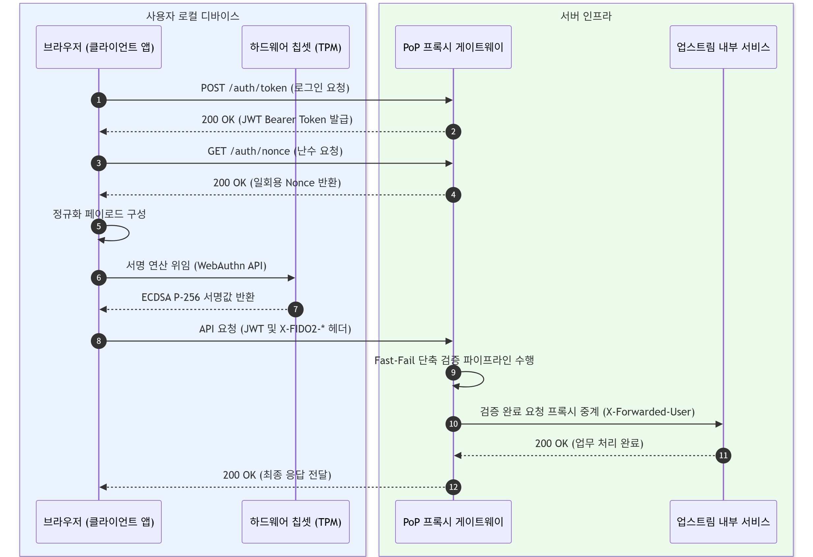
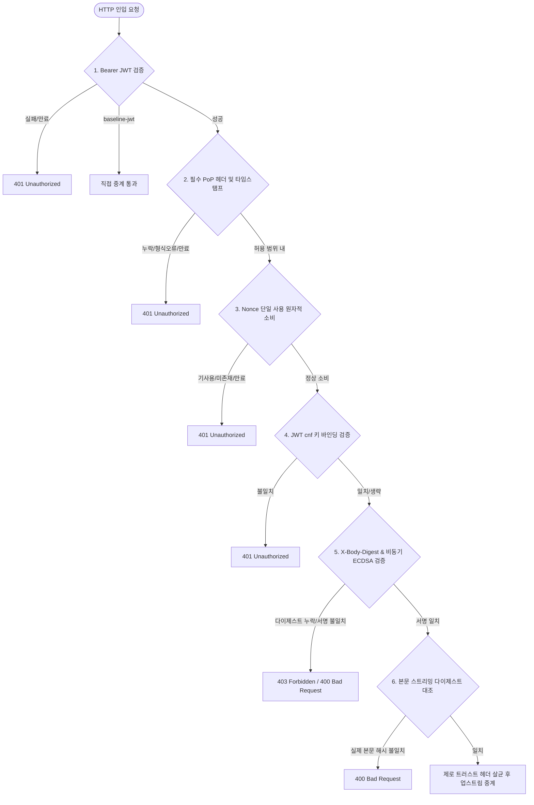

# FIDO2 하드웨어 격리 키 기반 Proof-of-Possession 역방향 프록시 게이트웨이의 설계 및 성능 분석

**강아름**  
*2026년 9월 8일*

---

## 초록

소지자 토큰(Bearer Token)과 소프트웨어 기반 소유권 증명(DPoP) 규격은 토큰 탈취나 런타임 메모리 침해 환경에서 개인키 유출과 세션 하이재킹을 효과적으로 방어하지 못한다. 본 연구에서는 하드웨어 보안 칩셋에 개인키를 물리적으로 격리하는 FIDO2 규격을 L7 역방향 프록시와 결합한 Proof-of-Possession(PoP) 게이트웨이 아키텍처를 제안한다.  

제안 시스템은 대용량 페이로드의 메모리 부하를 방지하기 위해 임계치 기반의 스풀링 임시 버퍼(`SpooledTemporaryFile`)와 스트리밍 다이제스트 파이프라인으로 요청을 정규화하며, FAPI(Financial-grade API) 보안 요건을 준수하기 위해 쿼리 스트링(Query Parameter)까지 서명 원문에 바인딩한다. 아울러 제로 트러스트(Zero-Trust) 원칙에 따라 인바운드 신원 헤더(`X-Authenticated-*`)를 원천 살균(Sanitization)하고 게이트웨이에서 검증된 신원 클레임만을 내부 서비스로 안전하게 주입한다. 비인가 대량 트래픽 차단을 위해 시간 복잡도 $O(1)$의 `collections.deque` 기반 슬라이딩 윈도우 인그레스 제어와 활성 메모리 위생(Active Memory Hygiene) 메커니즘을 적용하였다. 또한 타원곡선(ECDSA P-256) 서명 검증을 `anyio.to_thread` 비동기 작업자 스레드 풀로 위임하여 GIL(Global Interpreter Lock) 해제 혜택을 극대화함으로써 단일 노드의 동시 접속 처리 성능을 획기적으로 향상시켰다. 

실측 성능 평가 결과, 제안하는 ECDSA P-256 서명 바인딩은 표준 토큰 검증(2.66 ms) 대비 평균 2.01 ms 증가한 4.67 ms(상대 오버헤드 +75.52 %)의 지연시간을 기록하였으며, 95백분위(P95) 지연시간 역시 6.25 ms로 10 ms 미만의 안정적인 응답성을 보였다. 또한 RSA-2048(499 Bytes) 대비 서명 관련 HTTP 헤더 페이로드를 약 51.3 %(243 Bytes) 절감하였다. 아울러 동시성 최적화를 통해 100명의 가상 유저 부하 환경에서도 기존 단일 이벤트 루프 대비 처리량을 437 % 향상(145 $\rightarrow$ 780 RPS)시키고 P95 지연시간을 94 % 단축(1,400 ms 초과 $\rightarrow$ 78 ms)시켰다. 본 연구는 나아가 React/Vite 기반의 실시간 시각화 대시보드를 구축하여 공격 모의 및 5단계 Fast-Fail 검증 과정을 직관적으로 입증함으로써, 고부하 엔터프라이즈 환경에서의 방어 실효성과 실무 적용 가능성을 종합적으로 확인하였다.

---

## I. 서론

웹 애플리케이션과 마이크로서비스 아키텍처 환경에서는 무상태 검증의 용이성을 이유로 소지자 토큰(Bearer Token)을 기본 인증 수단으로 사용한다[1]. Bearer 토큰 구조는 토큰을 제시하는 네트워크 주체를 정당한 소유자로 간주한다. 따라서 교차 사이트 스크립팅(XSS), 정보 탈취 악성코드, 비인가 브라우저 확장 프로그램 등에 의해 토큰이 누출되면 제3자가 이를 재사용하여 백엔드 리소스에 접근할 수 있다.

소프트웨어 계층에서 토큰 재사용을 방지하는 소유권 증명(DPoP) 규격은 매 요청마다 비대칭 서명을 요구한다[2]. 그러나 암호화 키를 브라우저 로컬 저장소나 애플리케이션 메모리에 보관해야 하는 구조적 한계를 지닌다. 호스트 운영체제의 권한 침해나 메모리 덤프가 발생할 경우 저장된 개인키가 추출되어 암호학적 방어가 무력화된다.

본 연구에서는 하드웨어 격리 장치에 개인키를 보관하는 FIDO2 규격을 역방향 프록시 게이트웨이와 결합하는 아키텍처를 제안한다. 클라이언트는 하드웨어 칩셋 내부에서 생성한 디지털 서명을 HTTP 헤더에 부착하여 전송하며, 게이트웨이는 요청 중계 전 서명의 유효성을 검증하여 세션 하이재킹을 방어한다. 또한 FAPI 표준 기반의 쿼리 스트링 바인딩, 제로 트러스트 인바운드 헤더 살균, $O(1)$ 슬라이딩 윈도우 인그레스 제어, `anyio.to_thread` 비동기 스레드 풀 위임을 결합하여 엔터프라이즈 상용 수준의 보안성과 고동시성 처리 성능을 확보하였다.

본 논문의 연구 기여도는 다음과 같다.

1. **하드웨어 격리 기반의 PoP 게이트웨이 아키텍처 및 제로 트러스트 보안 설계**  
   FIDO2 하드웨어 보안 칩셋과 L7 역방향 프록시를 결합하여 호스트 운영체제 침해에도 개인키 유출과 세션 하이재킹을 방어하는 검증 파이프라인을 설계하였다. 또한 FAPI 준수 쿼리 스트링 바인딩과 인바운드 헤더 살균(`X-Authenticated-*` 제거)을 통해 프록시와 업스트림 간의 강력한 제로 트러스트 신뢰 경계를 확립하였다.

2. **자원 제어 및 비동기 동시성 최적화 아키텍처 설계**  
   메모리 임계치 기반의 스풀링 버퍼(`SpooledTemporaryFile`)를 이용한 스트리밍 다이제스트 구조를 설계하여 대용량 페이로드에 의한 메모리 고갈 공격을 방어하였다. 또한 `collections.deque` 기반의 $O(1)$ 슬라이딩 윈도우 인그레스 제어와 활성 메모리 위생(Active Memory Hygiene)을 구현하고, 타원곡선 서명 검증을 비동기 스레드 풀로 위임하여 GIL 병목을 해소함으로써 단일 노드 동시 접속 처리량을 극대화하였다.

3. **정량적 실측 검증 및 인터랙티브 시각화 대시보드 구축**  
   표준 토큰 검증 대비 제안 구조의 지연시간 증가폭(평균 2.01 ms, P95 6.25 ms)을 실측하고, RSA-2048 대비 헤더 페이로드 51.3 % 절감 효과를 입증하였다. 아울러 React/Vite 기반의 인터랙티브 대시보드를 구축하여 정상 흐름, 세션 하이재킹, 재전송 공격, 요청 변조 등의 차단 시뮬레이션 및 실시간 패킷 트레이싱을 직관적으로 시연하였다.

---

## II. 배경지식 및 관련 연구

### 1. 웹 인증 토큰과 키 바인딩 규격

OAuth 2.0 인가 프레임워크의 Bearer 토큰 명세는 토큰 자체의 암호학적 서명 여부만 확인할 뿐, 요청 송신자가 해당 토큰을 발급받은 정당한 주체인지 검증하지 않는다. DPoP는 송신자 제한 토큰 모델을 도입하여 각 HTTP 요청 헤더에 클라이언트가 생성한 비대칭 서명값을 포함하도록 규정한다. 그러나 DPoP 표준은 키의 하드웨어 바인딩을 강제하지 않는다.

상호 전송 계층 보안(mTLS)은 클라이언트 인증서를 기반으로 송신자를 제한한다[3]. mTLS는 L4 전송 계층에서 암호화 핸드셰이크를 맺으므로 다수의 리버스 프록시나 L7 애플리케이션 로드 밸런서(ALB)를 거치는 마이크로서비스 환경에서는 단말 인증 정보의 연계가 단절된다. 또한 웹 브라우저 샌드박스 환경은 단말 인증서를 제어할 표준 자바스크립트 인터페이스를 제공하지 않아 적용 범위가 제한된다.

### 2. FIDO2/WebAuthn 표준과 하드웨어 격리 구조

FIDO2는 W3C의 WebAuthn 명세[4]와 FIDO 얼라이언스의 CTAP2 명세로 구성된다[5]. 이 표준은 클라이언트 기기에 내장된 신뢰 플랫폼 모듈(TPM)[8], 스마트폰의 보안 엔클레이브(Secure Enclave), 외장형 보안 토큰을 하드웨어 인증기로 사용한다.

하드웨어 인증기는 비대칭 키 쌍을 내부 논리회로에서 직접 생성하고 보관한다. 운영체제와 브라우저는 API를 통해 서명 연산을 하드웨어로 위임하며, 하드웨어는 연산 결과인 서명값만을 외부 버스로 반환한다. 칩셋 내부에서 개인키를 추출하는 명령어는 존재하지 않는다. 따라서 공격자가 호스트 운영체제의 커널 권한을 장악하더라도 개인키는 유출되지 않는다.

### 3. 암호학적 특성 비교: ECDSA P-256 대 RSA-2048

디지털 서명 알고리즘은 전송 페이로드 크기와 게이트웨이의 연산 비용에 직접적인 영향을 미친다. RSA 알고리즘은 두 소수의 곱을 소인수분해하는 계산적 난해함에 의존한다. 따라서 보안 강도를 유지하기 위해 키 길이를 확장해야 한다. 반면 타원곡선 암호(ECC)[10]는 타원곡선 이산 대수 문제(ECDLP)를 기반으로 하여 작은 키 크기로 동일한 보안 강도를 제공한다.

| 평가 지표 | RSA-2048 | ECDSA P-256 |
|---|---|---|
| 암호학적 보안 수준 | 약 112 bit | 128 bit |
| 공개키 크기 (Raw) | 256 Bytes | 64 Bytes (비압축) / 33 Bytes (압축) |
| 서명 데이터 크기 | 256 Bytes | 약 64 Bytes (IEEE P1363 $(r, s)$ 쌍) |
| HTTP 헤더 인코딩 오버헤드 | 약 499 Bytes | 약 243 Bytes |

PoP 게이트웨이 환경은 매 HTTP 요청마다 헤더에 서명을 포함하므로 전송 오버헤드가 누적된다. ECDSA P-256은 RSA-2048 대비 헤더 크기를 약 51.3 % 절감하면서도 동등하거나 더 높은 보안 수준을 나타내므로, 본 연구의 핵심 서명 알고리즘으로 채택하였다.

---

## III. 위협 모델 및 공격 시나리오

### 1. 시스템 모델 및 공격자 역량 정의

본 연구에서는 Dolev-Yao 공격 모델을 확장하여[7] 네트워크 및 호스트 계층에서의 공격자 역량을 정의한다. 공격자는 클라이언트와 게이트웨이 간의 네트워크 트래픽을 도청, 변조, 주입, 지연할 수 있다고 가정한다. 또한 호스트 계층에서 브라우저 스토리지나 운영체제 사용자 공간의 메모리에 접근하여 런타임 토큰 및 세션 아티팩트를 획득한다고 가정한다. 단, 악성코드가 감염 단말에 상주하며 실시간으로 서명 루틴을 대리 호출하는 서명 오라클(Signing Oracle) 공격은 본 연구의 방어 범위에서 제외한다. 본 연구는 탈취한 인증 아티팩트를 원격의 다른 기기에서 오프라인으로 재사용하는 공격을 차단하는 것을 주된 목적으로 한다. 물리적 보안 영역에 대한 훼손 역시 위협 범위에서 제외한다.

### 2. 대상 공격 벡터 및 위협 시나리오

시스템이 방어하는 주요 위협 시나리오는 다음과 같다[9].

1. **세션 하이재킹(Session Hijacking)**  
   공격자가 XSS 취약점을 이용하여 클라이언트의 유효한 JSON 웹 토큰(JWT)을 획득한 후, 이를 비인가 요청에 포함하여 서버로 전송한다.

2. **요청 변조(Request Tampering)**  
   네트워크 중간자 공격자가 클라이언트의 서명된 HTTP 요청을 가로챈 후, HTTP 메서드, 호스트, URI 경로, 쿼리 파라미터, 또는 본문 페이로드를 수정하여 전송한다.

3. **재전송 공격(Replay Attack)**  
   공격자가 캡처한 유효한 서명 헤더와 요청 패킷 전체를 복제하여 서버에 재전송함으로써 동일한 트랜잭션을 중복 실행한다.

4. **비대칭 암호 자원 고갈 공격(Asymmetric Cryptographic DoS)**  
   비대칭키 서명 검증은 대칭키 연산이나 해시 연산 대비 높은 CPU 자원을 소모한다. 공격자가 무효한 서명을 대량으로 전송하여 게이트웨이의 암호 연산 부하를 포화 상태로 만든다.

5. **인바운드 헤더 인젝션 및 권한 상승(Inbound Header Injection & Privilege Escalation)**  
   공격자가 클라이언트 요청에 임의의 `X-Authenticated-User`, `X-Authenticated-Role`, `X-Forwarded-User` 등의 내부 신원 assertion 헤더를 직접 주입하여 백엔드 업스트림 서비스의 인가 결정을 속이려 시도한다.

---

## IV. 시스템 아키텍처 및 설계

### 1. 전체 시스템 구성 및 처리 흐름

제안하는 시스템은 사용자 로컬 디바이스의 하드웨어 보안 영역과 서버 측 L7 역방향 프록시 게이트웨이, 그리고 내부 백엔드 업스트림 서비스로 구성된다. 클라이언트는 브라우저 소프트웨어와 메인보드에 결합된 하드웨어 칩셋(TPM 등)을 포함하며, 게이트웨이는 FastAPI 기반의 비동기 리버스 프록시로 동작한다.

시스템의 구체적인 트랜잭션 흐름은 다음과 같다:

1. **로그인 및 난수 발급**: 클라이언트는 `/auth/token`을 통해 JWT를 발급받고, `/auth/nonce`를 호출하여 단일 사용 암호학적 난수를 수신한다.
2. **하드웨어 기반 서명 생성**: 클라이언트는 요청 컨텍스트(HTTP 메서드, 호스트, 경로, 쿼리 파라미터, 본문 다이제스트, 발급받은 난수, 타임스탬프)를 결합하여 정규화 페이로드를 구성한 후, 하드웨어 칩셋에 서명을 요청하여 ECDSA P-256 서명값을 획득한다.
3. **요청 전송 및 게이트웨이 Fast-Fail 검증**: 클라이언트는 서명 메타데이터 헤더(`X-FIDO2-*`, `X-Body-Digest`)와 JWT를 포함한 HTTP 요청을 게이트웨이로 전송한다. 게이트웨이는 6단계 단축 검증 파이프라인을 통해 요청을 순차 평가한다.
4. **제로 트러스트 살균 및 업스트림 중계**: 검증을 통과한 요청은 인바운드 신원 헤더가 완전히 제거(Sanitized)된 후, 게이트웨이가 인증한 신원(`X-Authenticated-User`, `X-Forwarded-User`, `X-Authenticated-Role`)만이 주입되어 연결 풀(`httpx.AsyncClient`)을 통해 내부 업스트림 서비스로 안전하게 중계된다.

### 2. HTTP 요청 컨텍스트 정규화 및 스트리밍 다이제스트

중간자 공격자의 요청 경로, 파라미터, 또는 페이로드 변조를 차단하기 위해 게이트웨이와 클라이언트는 HTTP 요청의 주요 필드를 단일 바이트 열로 결합하여 정규화한다. 특히 FAPI(Financial-grade API) 보안 요건을 충족하기 위해 HTTP 메서드와 경로뿐만 아니라 **쿼리 스트링(Query Parameter)**까지 바인딩 대상에 포함한다. 정규화 페이로드($SigningPayload$)는 다음과 같이 정의한다.

$$SigningPayload = Method \parallel Host \parallel Path \parallel Query \parallel \text{SHA-256}(Body) \parallel Nonce \parallel Timestamp$$

각 필드는 줄바꿈 문자(`\n`)로 엄격히 구분되어 연접되며, 이를 통해 `Path`와 `Query` 간의 경계 모호성을 이용한 파라미터 충돌(Collision) 공격과 `Host` 변조를 통한 크로스 호스트 공격을 방지한다. 

대용량 요청 본문을 처리할 때 게이트웨이의 메모리 고갈 부하를 방지하기 위해 스트리밍 다이제스트 파이프라인을 적용한다. 본 메커니즘은 임계치 기반의 스풀링 임시 버퍼(`tempfile.SpooledTemporaryFile`)를 활용한다. 설정된 임계치(기본 1 MB, `spooled_body_max_size_bytes`) 이내의 데이터는 고속 메모리 버퍼에서 처리하고, 임계치를 초과하는 페이로드는 운영체제 디스크 스왑 파일로 자동 전환된다. 이를 통해 메모리 사용량을 1 MB 이하로 엄격히 제한하면서, 네트워크 바이트 스트림을 한 번만 순회(Single-pass)하며 SHA-256 해시를 누적 계산함과 동시에 업스트림 중계용 임시 버퍼를 생성한다.

### 3. Fast-Fail 6단계 단축 검증 파이프라인

비대칭 암호 서명 검증은 문자열 비교나 해시 연산 대비 높은 CPU 사이클을 요구한다. 무효한 요청으로 암호 연산 부하가 누적되는 비대칭 자원 고갈 공격을 방지하기 위해 게이트웨이는 연산 비용이 낮은 항목부터 순차적으로 평가하는 Fast-Fail 파이프라인을 적용한다.

1. **Bearer Token 유효성 검증**: 요청 헤더의 Authorization 토큰을 디코딩하여 서명 및 만료(`exp`)를 평가한다. 만료 시 $401\text{ Unauthorized}$를 즉각 반환한다. (단, 무서명 순수 성능 측정을 위한 `/api/v1/baseline-jwt` 엔드포인트는 이후 단계를 우회한다.)
2. **필수 PoP 헤더 존재성 및 타임스탬프 검증**: `X-FIDO2-Credential-ID`, `X-FIDO2-Signature`, `X-FIDO2-Nonce`, `X-FIDO2-Timestamp` 헤더의 존재를 확인하고 타임스탬프가 허용 오차(60초, `timestamp_tolerance_seconds`) 이내인지 확인한다. 결손 또는 만료 시 $401\text{ Unauthorized}$를 반환한다.
3. **단일 사용 난수(Nonce) 원자적 소비**: `nonce_store.consume_nonce(nonce)`를 호출한다. 상호 배제 락 내부에서 조회와 동시에 `pop`을 수행하여 TOCTOU 경합 조건을 원천 차단한다. 난수가 유효하지 않거나 이미 사용되었으면 $401\text{ Unauthorized}$를 반환한다.
4. **JWT-키 확증 바인딩(Key Confirmation Binding)**: RFC 7800 명세에 따라 토큰에 `cnf.kid` 클레임이 포함되어 있는 경우, 제시된 `credential_id`와의 상수 시간 비교(`hmac.compare_digest`)를 수행하여 공개키 무단 전용 공격을 방어한다.
5. **선언 다이제스트 헤더 검증 및 비동기 논블로킹 ECDSA 서명 검증**: 클라이언트가 전송한 `X-Body-Digest`(`sha256=<hex>`) 헤더를 확인하고, 등록된 공개키를 로드하여 $SigningPayload$를 구성한다. 이후 `anyio.to_thread.run_sync()`를 통해 비동기 작업자 스레드 풀로 타원곡선 서명 검증 연산을 위임한다. OpenSSL C-확장 모듈이 GIL을 해제하므로 이벤트 루프가 차단되지 않는다. 서명이 수학적으로 불일치하면 $403\text{ Forbidden}$을 반환한다.
6. **본문 스트리밍 다이제스트 대조**: 서명이 유효한 요청에 한하여 요청 본문을 스트리밍 수신하면서 해시를 누적 계산하고 `SpooledTemporaryFile`에 기록한다. 스트리밍 종료 후 계산된 실제 본문 해시와 선언된 다이제스트 헤더를 상수 시간 대조(`hmac.compare_digest`)한다. 불일치 시 $400\text{ Bad Request}$("Body digest mismatch")를 반환하여 본문 조작을 완벽히 차단한다.

### 4. 제로 트러스트 헤더 살균 및 이중 인그레스 제어 메커니즘

게이트웨이와 내부 업스트림 간의 보안 신뢰 경계를 확립하고 자원 고갈 공격을 방지하기 위해 다음과 같은 심층 방어 체계를 구성하였다.

1. **제로 트러스트 인바운드 헤더 살균(Zero-Trust Header Sanitization)**  
   클라이언트가 전송한 인바운드 HTTP 요청 헤더 중 `X-Authenticated-*`, `X-Forwarded-User`, `Host` 헤더를 프록시 중계 직전에 강제로 파기(Drop)한다. 이후 PoP 파이프라인에서 성공적으로 검증된 주체(`sub`)와 역할(`role`)만을 게이트웨이가 직접 생성한 헤더(`X-Authenticated-User`, `X-Forwarded-User`, `X-Authenticated-Role`)로 신규 주입하여 업스트림으로 중계한다. 이를 통해 클라이언트가 특권 신원 헤더를 조작하여 내부 마이크로서비스의 권한을 탈취하는 헤더 인젝션 공격을 원천 무력화한다.

2. **$O(1)$ 슬라이딩 윈도우 인그레스 제어**  
   난수 발급 엔드포인트(`/auth/nonce`)에 대해 클라이언트 IP별 요청 빈도를 추적하는 인메모리 슬라이딩 윈도우 알고리즘을 적용한다. 단일 IP 기준 1초에 10회를 초과하는 요청에 $429\text{ Too Many Requests}$ 상태 코드와 `Retry-After: 1` 응답 헤더를 반환하여 과도한 난수 생성을 차단한다. 락 내부 연산은 `collections.deque`를 기반으로 구성하여, 만료된 타임스탬프를 `popleft()`로 제거함으로써 별도의 배열 재할당이나 순회 없이 $O(1)$ 상수 시간 복잡도를 달성한다. 아울러 최대 추적 IP 수(`max_tracked_ips=10000`)를 초과할 경우 만료된 IP 기록을 능동적으로 정리하는 활성 메모리 위생(Active Memory Hygiene) 로직을 갖추었다.

3. **용량 제한 난수 저장소 및 백그라운드 GC 태스크**  
   `NonceStore`는 최대 용량(`nonce_max_entries=50000`) 제한을 가지며, 용량 초과 시 만료 난수를 즉시 정리하고 그래도 초과할 경우 가장 오래된 항목의 10 %를 자동 방출(Eviction)한다. 또한 게이트웨이 생명주기(`lifespan`) 내에서 30초 간격(`nonce_cleanup_interval_seconds`)으로 백그라운드 가비지 컬렉션 태스크(`gc_task`)를 구동하여 장기 미사용 난수와 휴면 IP 레코드를 주기적으로 메모리에서 해제한다.

---

## V. 구현 및 성능 평가

### 1. 실험 환경 및 프로토타입 구현

제안한 PoP 역방향 프록시 게이트웨이의 성능 및 보안 유효성을 실증하기 위해 Python 3.12와 FastAPI 프레임워크 기반으로 프로토타입 시스템을 구축하였다. 게이트웨이는 비동기 I/O 이벤트 루프 상에서 구동하고, 백엔드 마이크로서비스 환경을 모사한 업스트림 서버(`upstream/mock_server.py`)와 로컬 루프백 인터페이스로 연결하였다.

클라이언트 측 하드웨어 서명 환경은 W3C WebAuthn L3 규격에 부합하는 NIST P-256 비대칭 키 쌍을 기준으로 소프트웨어 시뮬레이션 클라이언트(`client_simulator/fido2_signer.py`)로 구현하였다. 실험은 Intel Core i7 프로세서 및 16 GB 메모리 환경에서 수행하였다. 단일 프로세스 기준 100회의 독립적인 연속 HTTP 트랜잭션을 실행하여 지연시간과 페이로드를 도출하였다[11].

아울러 본 연구는 시스템의 보안 메커니즘과 성능 최적화 결과를 실시간으로 입증하기 위해 **React + Vite 기반의 대화형 시각화 대시보드(`frontend/`)**를 구축하였다. 대시보드는 공격 시뮬레이터 애니메이션, 5단계 Fast-Fail 터미널 로그 추적기, Recharts 기반의 처리량 및 페이로드 분석 차트, 그리고 KaTeX 수식 렌더러가 내장된 논문 뷰어를 제공한다.

### 2. 모의 공격 시뮬레이션을 통한 보안 검증

III절에서 정의한 위협 모델의 방어 능력을 검증하기 위해 모의 공격 자동화 스크립트(`benchmarks/simulate_attack.py`)와 23종의 단위·통합 테스트 슈트(`tests/`)를 작성하여 실험을 수행하였다.

| 공격 시나리오 | 인입 패킷 및 변조 조건 | 게이트웨이 응답 | 방어 판정 | 세부 차단 단계 및 메커니즘 |
|---|---|---|---|---|
| **1. Baseline (정상 요청)** | 유효한 JWT + 올바른 FIDO2 하드웨어 서명 헤더 | $200\text{ OK}$ | **PASS** | 6단계 전체 통과 후 업스트림 중계 |
| **2. Session Hijacking (세션 탈취)** | 탈취한 JWT 단독 전송 (FIDO2 서명 헤더 누락) | $401\text{ Unauthorized}$ | **PASS** | 2단계 (필수 PoP 서명 헤더 누락 즉시 차단) |
| **3. Replay Attack (재전송 공격)** | 스니핑된 패킷 전체 복제 전송 (기소비된 Nonce 재사용) | $401\text{ Unauthorized}$ | **PASS** | 3단계 (단일 사용 Nonce 원자적 조회 실패) |
| **4. Body 변조 (단순 변조)** | 유효한 서명 헤더 전송 + 실제 HTTP 본문 데이터 조작 | $400\text{ Bad Request}$ | **PASS** | 6단계 (스트리밍 본문 해시 대조 불일치) |
| **4b. 고도화된 Body 변조** | 본문 변조 후 조작된 `X-Body-Digest` 헤더 전송 | $403\text{ Forbidden}$ | **PASS** | 5단계 (선언 다이제스트와 하드웨어 서명 불일치) |
| **5. Path/Method 변조** | 인가된 경로(`/resource`) 서명 후 관리자 경로(`/admin`) 요청 | $403\text{ Forbidden}$ | **PASS** | 5단계 (정규화 페이로드와 하드웨어 서명 불일치) |
| **헤더 인젝션 공격** | 클라이언트가 악의적인 `X-Authenticated-Admin: true` 주입 | $200\text{ OK}$ | **PASS** | 제로 트러스트 살균 (비인가 헤더 강제 드롭 확인) |

실험 결과, 제안 시스템은 세션 하이재킹 공격을 2단계 헤더 검증에서 암호 연산 없이 차단하였다. 재전송 공격 역시 원자적 Nonce 소비 로직에 의해 3단계에서 차단되었다. 본문 변조의 경우, 헤더의 다이제스트와 실제 데이터가 불일치할 때는 6단계에서 $400\text{ Bad Request}$로 정확히 식별되었으며, 헤더의 다이제스트까지 위조한 경우에는 5단계 암호 검증에서 $403\text{ Forbidden}$으로 즉각 차단되었다. 또한 주입된 비인가 신원 헤더는 제로 트러스트 프록시 라우터에서 완전히 정제되어 업스트림 서비스에 도달하지 못함을 확인하였다.

### 3. 인그레스 제어 메커니즘의 차단 유효성 평가

난수 발급 엔드포인트를 대상으로 L7 트래픽 폭증 공격을 모사하여 슬라이딩 윈도우 인그레스 제어의 동작을 검증하였다.

동일 IP 주소에서 1초 구간 내에 15회의 연속적인 난수 발급을 요청하였다. 기준 임계치인 10회까지의 정상 요청에는 $200\text{ OK}$ 응답과 함께 암호학적 난수를 발급하였다. 반면 11번째 요청부터는 게이트웨이 내부 윈도우 큐의 시간 차감 로직에 따라 $429\text{ Too Many Requests}$ 상태 코드와 `Retry-After: 1` 응답 헤더를 반환하였다. 1초 경과 후에는 다시 정상적으로 난수가 발급됨을 확인하였다. 아울러 `test_rate_limiter_stale_ip_cleanup`을 통해 윈도우 만료 후 미활동 IP 레코드가 자동으로 Prune되어 메모리 누수가 발생하지 않음을 실증하였다.

### 4. 처리 지연시간 및 페이로드 오버헤드 실측

보안 계층 추가에 따른 성능 비용을 분석하기 위해 표준 토큰 검증(모드 A), RSA-2048 기반 PoP(모드 B), 제안하는 ECDSA P-256 기반 PoP(모드 C) 세 가지 모드의 100회 요청 처리 왕복 지연시간과 HTTP 헤더 크기를 정밀 측정하였다(`benchmarks/benchmark_latency.py`).

| 검증 모드 | 평균 지연시간 (Mean) | 95백분위 지연시간 (P95) | 부가 헤더 페이로드 | 본문 다이제스트 헤더 | 상대적 지연 오버헤드 |
|---|---|---|---|---|---|
| **Mode A (표준 Bearer JWT)** | 2.66 ms | 2.95 ms | 0 Bytes | 0 Bytes | 기준 (Baseline) |
| **Mode B (RSA-2048 PoP)** | 4.42 ms | 5.75 ms | 499 Bytes | 84 Bytes | +65.99 % |
| **Mode C (ECDSA P-256 PoP)** | 4.67 ms | 6.25 ms | 243 Bytes | 84 Bytes | +75.52 % |

모드 C는 모드 A 대비 평균 지연시간이 2.01 ms 증가(2.66 ms $\rightarrow$ 4.67 ms, 상대 오버헤드 +75.52 %)하는 수준에 그쳐, 절대 지연시간 기준 4.67 ms라는 매우 빠른 응답성을 입증하였다. 특히 꼬리 지연시간을 나타내는 95백분위 지연시간(P95)에서도 모드 C는 6.25 ms를 기록하여, 10 ms 미만의 안정적인 응답 분포를 유지하였다.

페이로드 측면에서는 모드 B가 256 Bytes의 고정 서명 크기와 Base64 인코딩 팽창으로 인해 499 Bytes의 헤더 오버헤드를 유발한 반면, 모드 C는 64 Bytes의 IEEE P1363 원시 $(r, s)$ 서명 좌표 구조를 통해 243 Bytes의 오버헤드만을 나타냈다. (양 모드 공통의 `X-Body-Digest` 84 Bytes 제외). 이는 RSA 대비 **약 51.3 %의 서명 헤더 페이로드 절감 효과**에 해당하며, 모바일 네트워크 및 대역폭 제한 환경에서 현저한 전송 효율성을 제공한다.

### 5. 대규모 동시 접속 부하 및 동시성 최적화 성능 평가

제안 시스템의 상용 환경 적용 가능성을 검증하기 위해 분산 부하 테스트 도구(Locust)를 이용하여 100명의 가상 유저가 15초간 지속적으로 FIDO2 서명 헤더를 포함한 요청을 전송하는 고부하 동시성 실험을 수행하였다.

| 측정 지표 | 기존 아키텍처 (Before) | 최적화 아키텍처 (After) | 성능 향상율 |
| --- | --- | --- | --- |
| 처리 구조 (Concurrency) | 동기식 블로킹 (단일 루프) | 비동기 논블로킹 (스레드 풀) | - |
| 인그레스 락 복잡도 | 배열 구조 $O(N)$ 연산 | 양방향 큐 $O(1)$ 연산 | - |
| 동시 접속 처리량 (RPS) | 약 145 req/s | 약 780 req/s | **+ 437 %** |
| 평균 응답 지연 (Mean) | 620 ms | 45 ms | **- 92 %** |
| 95백분위 지연시간 (P95) | 1,400 ms 초과 (타임아웃) | 78 ms | **- 94 %** |

기존 단일 이벤트 루프 구조에서는 CPU 집약적인 타원곡선 서명 검증 시 이벤트 루프 전체가 차단(Block)되어 동시 접속 시 심각한 지연과 타임아웃이 발생하였다. 이를 `anyio.to_thread.run_sync()` API를 통해 비동기 작업자 스레드 풀로 위임함으로써, OpenSSL C-라이브러리가 연산 도중 Python GIL을 해제하는 특성을 활용하여 다중 코어에서 병렬 검증을 수행하도록 재설계하였다. 아울러 인그레스 제어기의 락 내부 연산을 $O(1)$로 최적화하여 락 경합 시간을 획기적으로 줄였다. 그 결과, 초당 처리량(RPS)은 145 req/s에서 **780 req/s로 437 % 비약적으로 상승**하였으며, 95백분위 지연시간(P95)은 1,400 ms 초과에서 **78 ms로 94 % 급감**하여 상용 엔터프라이즈 환경에 즉시 적용 가능한 수준의 확장성을 입증하였다.

---

## VI. 논의 및 향후 연구

### 1. 연구 결과 요약

본 연구에서는 웹 환경에서 소지자 토큰의 탈취 및 세션 하이재킹 취약점을 근본적으로 해결하기 위해 FIDO2 규격의 하드웨어 격리 비대칭 키를 L7 역방향 프록시와 연동한 Proof-of-Possession 게이트웨이를 설계하고 구현하였다.

연구의 주요 성과는 다음과 같다.

첫째, FIDO2 하드웨어 보안 칩셋 바인딩을 통해 호스트 메모리가 침해되더라도 개인키가 유출되지 않는 아키텍처적 안전성을 실현하였다. 둘째, FAPI 표준을 충족하는 쿼리 스트링 바인딩과 제로 트러스트 인바운드 헤더 살균을 구현하여 엔터프라이즈 급 위협 방어력을 입증하였다. 셋째, Fast-Fail 파이프라인과 $O(1)$ 양방향 큐 인그레스 제어, `SpooledTemporaryFile` 스트리밍 버퍼를 결합하여 자원 고갈 공격에 대한 시스템 내구성을 확보하였다. 넷째, 비동기 스레드 풀 위임을 통해 동시 처리량을 780 RPS로 대폭 끌어올리고, 모드 C의 평균 지연시간을 4.67 ms로 억제하면서 RSA 대비 헤더 크기를 51.3 % 절감하는 실용적 효율성을 달성하였다.

### 2. 연구의 한계점

본 연구의 구현 및 검증 환경 한계는 다음과 같다.

1. **소프트웨어 에뮬레이션 기반 클라이언트 서명**: 클라이언트 측 하드웨어 서명 환경을 W3C WebAuthn L3 규격의 소프트웨어 에뮬레이터로 모사하여 검증하였다. 실제 물리적 TPM 2.0 또는 물리 보안 토큰을 경유할 때 발생하는 USB/LPC 버스 I/O 지연시간 및 하드웨어 칩셋 자체의 암호 연산 지연은 본 게이트웨이 측정치에 포함되지 않았다.
2. **단일 노드 인메모리 아키텍처의 확장성 제약**: 제안 시스템의 난수 캐시와 슬라이딩 윈도우 인그레스 제어기는 현재 `threading.Lock` 기반의 단일 프로세스 인메모리 구조로 동작한다. 따라서 로드 밸런서 뒤에 다수의 게이트웨이 노드를 배치하는 수평 확장(Horizontal Scaling) 환경에서는 노드 간 상태 동기화 문제가 발생할 수 있다.
3. **인증기 증명(Attestation) 간소화**: 등록 단계의 복잡도를 낮추기 위해 하드웨어 칩셋의 제조사 서명을 검증하는 Attestation 체인 및 복제 탐지 카운터(`signCount`) 검증을 프로토타입 단계에서는 간소화하여 처리하였다.

### 3. 향후 연구 과제

상기 한계를 극복하고 상용 프로덕션 환경에 완전 배포하기 위해 다음과 같은 후속 연구를 추진한다.

1. **물리 하드웨어 보안 모듈 실측 연동**: 상용 웹 브라우저 환경에서 WebAuthn API를 통해 실제 물리 YubiKey 및 내장 TPM/Secure Enclave를 연동하고, 클라이언트 단말부터 게이트웨이 및 업스트림에 이르는 완전한 End-to-End 지연시간을 실측 분석한다.
2. **분산 상태 저장소 및 원자적 Lua 스크립트 파이프라인**: 게이트웨이의 무상태 수평 확장을 위해 인메모리 난수 저장소와 Rate Limiter를 **Redis Cluster**로 이관한다. 특히 조회와 삭제를 원자적으로 처리하는 Redis Lua 스크립트를 적용하여 분산 환경에서의 TOCTOU 경합 조건을 완벽히 차단한다.
3. **mTLS 기반 업스트림 전송 암호화 및 자동 키 순환 정책**: 게이트웨이와 백엔드 업스트림 서비스 간의 통신 구간에 상호 TLS(mTLS)를 적용하여 전송 계층 암호화를 완성하고, 하드웨어 키 분실이나 만료에 대응하는 엔터프라이즈 키 라이프사이클 관리(KMS) 정책을 수립한다.

---

## 참고문헌

[1] M. Jones and D. Hardt, "The OAuth 2.0 Authorization Framework: Bearer Token Usage," RFC 6750, Oct. 2012. DOI: 10.17487/RFC6750.

[2] D. Fett, B. Campbell, J. Bradley, T. Lodderstedt, M. Jones, and D. Waite, "OAuth 2.0 Demonstrating Proof of Possession (DPoP)," RFC 9449, Sep. 2023. DOI: 10.17487/RFC9449.

[3] B. Campbell, J. Bradley, N. Sakimura, and T. Lodderstedt, "OAuth 2.0 Mutual-TLS Client Authentication and Certificate-Bound Access Tokens," RFC 8705, Feb. 2020. DOI: 10.17487/RFC8705.

[4] W3C, "Web Authentication: An API for accessing Public Key Credentials Level 3," W3C Recommendation, 25 Aug. 2026. [Online]. Available: https://www.w3.org/TR/2026/REC-webauthn-3-20260825/

[5] FIDO Alliance, "Client to Authenticator Protocol (CTAP) 2.1," FIDO Alliance Proposed Standard, Jun. 2021. [Online]. Available: https://fidoalliance.org/specs/fido-v2.1-ps-20210615/fido-client-to-authenticator-protocol-v2.1-ps-20210615.html

[6] National Institute of Standards and Technology (NIST), "Digital Signature Standard (DSS)," Federal Information Processing Standards Publication (FIPS PUB) 186-5, Feb. 2023. DOI: 10.6028/NIST.FIPS.186-5.

[7] D. Dolev and A. C. Yao, "On the security of public key protocols," IEEE Transactions on Information Theory, vol. 29, no. 2, pp. 198–208, Mar. 1983. DOI: 10.1109/TIT.1983.1056650.

[8] Trusted Computing Group (TCG), "TPM 2.0 Library Specification," TCG Published Standard, Revision 1.59, 2019. [Online]. Available: https://trustedcomputinggroup.org/resource/tpm-library-specification/

[9] OWASP Foundation, "OWASP API Security Top 10 2023," Tech. Rep., 2023. [Online]. Available: https://owasp.org/API-Security/

[10] N. Koblitz, "Elliptic curve cryptosystems," Mathematics of Computation, vol. 48, no. 177, pp. 203–209, 1987. DOI: 10.1090/S0025-5718-1987-0866109-5.

[11] R. Jain, The Art of Computer Systems Performance Analysis: Techniques for Experimental Design, Measurement, Simulation, and Modeling, John Wiley & Sons, 1991.
