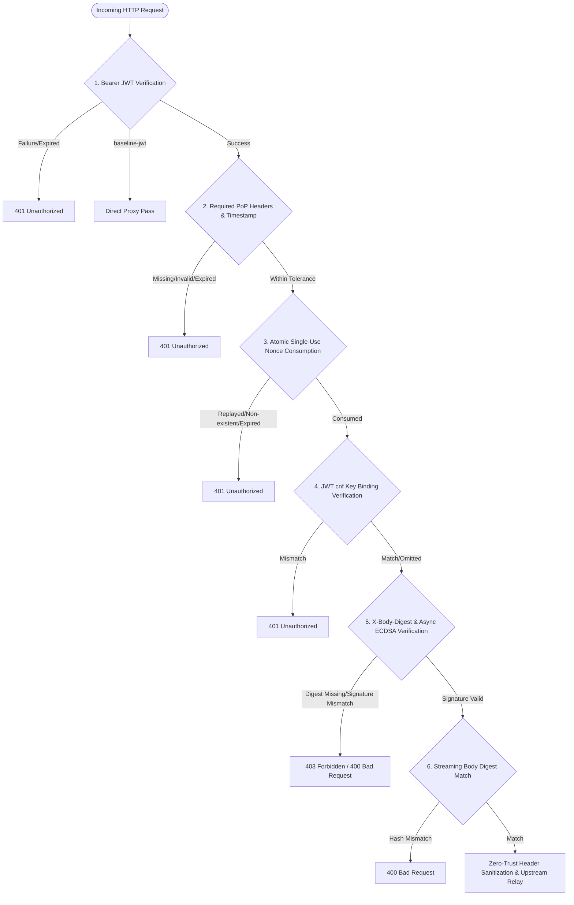

# Design and Performance Analysis of a FIDO2 Hardware-Isolated Key-Based Proof-of-Possession Reverse Proxy Gateway

**Ahrum Kang**  
*September 8, 2026*

---

## Abstract

Bearer tokens and software-based Demonstrating Proof-of-Possession (DPoP) specifications cannot fundamentally defend against private key exfiltration and session hijacking in environments where tokens are stolen or runtime memory is compromised. This paper proposes a Proof-of-Possession (PoP) gateway architecture that couples the FIDO2 specification—which physically isolates private keys within hardware security chipsets—with an L7 reverse proxy.

The proposed system normalizes requests through a threshold-based spooled temporary buffer (`SpooledTemporaryFile`) and a streaming digest pipeline to prevent memory exhaustion from large payloads, while binding query string parameters into the canonical signing payload to satisfy Financial-grade API (FAPI) security requirements. In accordance with Zero-Trust principles, incoming identity assertion headers (`X-Authenticated-*`) are sanitized at the gateway ingress, and only verified claims are injected into forwarded requests to upstream services. To block unauthorized bulk traffic, an in-memory sliding-window ingress control mechanism with $O(1)$ time complexity using `collections.deque` and active memory hygiene is implemented. Furthermore, elliptic curve (ECDSA P-256) signature verification is delegated to an asynchronous worker thread pool via `anyio.to_thread`, maximizing multi-core parallel processing through Global Interpreter Lock (GIL) release within the underlying cryptographic C-extensions.

Empirical evaluation results show that the proposed ECDSA P-256 signature binding incurs an average round-trip latency of 4.67 ms—an absolute increase of only 2.01 ms (+75.52% relative overhead) over baseline bearer token verification (2.66 ms)—while maintaining a stable 95th percentile (P95) latency of 6.25 ms. Additionally, it achieves an approximately 51.3% reduction in signature-related HTTP header payload (243 Bytes) compared to RSA-2048 (499 Bytes). Under a concurrent load of 100 virtual users, the asynchronous concurrency architecture increased throughput by 437% (from 145 to 780 requests per second) and reduced P95 latency by 94% (from >1,400 ms to 78 ms) compared to a synchronous single-loop baseline. Finally, an interactive React/Vite dashboard was developed to visually demonstrate attack simulations and the 5-stage Fast-Fail verification pipeline, confirming the system's operational viability and defense efficacy in high-throughput enterprise environments.

---

## I. Introduction

In web application and microservice architecture environments, bearer tokens are widely adopted as the standard authentication mechanism due to their stateless verification characteristics [1]. The bearer token model inherently presumes that whichever network entity presents a valid token is its legitimate possessor. Consequently, if a token is exfiltrated through cross-site scripting (XSS), credential-stealing malware, or unauthorized browser extensions, an adversary can reuse it indiscriminately to access backend protected resources.

The Demonstrating Proof-of-Possession (DPoP) specification, designed to prevent token reuse at the application layer, requires an asymmetric digital signature over each HTTP request [2]. However, DPoP suffers from a structural limitation: cryptographic keys reside in browser local storage or application memory. If the host operating system is compromised or memory inspection occurs, the stored private key can be extracted, rendering software-based cryptographic protections entirely ineffective.

To resolve these vulnerabilities, this paper proposes an architecture that integrates the FIDO2 specification—which physically isolates private keys within dedicated hardware security modules—with an L7 reverse proxy gateway. The client attaches a hardware-generated digital signature to request headers, and the gateway validates this cryptographic proof prior to routing traffic to internal services, eliminating session hijacking at the network perimeter. Furthermore, by incorporating FAPI-compliant query parameter binding, Zero-Trust inbound header sanitization, $O(1)$ sliding-window ingress control, and `anyio.to_thread` asynchronous thread pool offloading, the system achieves enterprise-grade security and robust high-concurrency throughput.

The primary contributions of this paper are as follows:

1. **Design of a Hardware-Isolated PoP Gateway Architecture and Zero-Trust Security Perimeter**  
   We design a verification pipeline coupling FIDO2 hardware security chipsets with an L7 reverse proxy, preventing private key theft and session hijacking even under full host operating system compromise. Furthermore, by enforcing FAPI-grade query string binding and stripping unverified inbound identity headers (`X-Authenticated-*`), we establish a robust Zero-Trust trust boundary between the gateway and internal microservices.

2. **Resource-Controlled and Asynchronously Optimized Concurrency Architecture**  
   We design a streaming digest pipeline utilizing a threshold-based spooled temporary buffer (`SpooledTemporaryFile`) to mitigate memory exhaustion denial-of-service attacks from oversized payloads. We also implement an $O(1)$ sliding-window rate limiter with active memory hygiene using `collections.deque`, and offload CPU-intensive elliptic curve verifications to a worker thread pool, releasing Python's GIL to maximize multi-core throughput on a single gateway node.

3. **Quantitative Empirical Validation and Interactive Visualization Dashboard**  
   We measure the precise round-trip latency overhead (mean 4.67 ms, P95 6.25 ms) and demonstrate a 51.3% reduction in HTTP header payload compared to RSA-2048. Additionally, we build an interactive React/Vite dashboard providing live packet tracing across system nodes, terminal logging of Fast-Fail pipeline execution, and quantitative performance analytics, demonstrating reproducible defense efficacy.

---

## II. Background and Related Work

### 1. Web Authentication Tokens and Key-Binding Specifications

The OAuth 2.0 Authorization Framework bearer token specification only validates the cryptographic signature of the token itself; it cannot ascertain whether the transmitting client is the legitimate party to whom the token was originally granted. DPoP addresses this by establishing a sender-constrained token model where the client creates an asymmetric signature over HTTP request attributes. Nevertheless, DPoP does not mandate hardware-backed key protection, leaving software-stored keys vulnerable to extraction via memory dumps, process inspection, or physical drive access on compromised endpoints.

Mutual Transport Layer Security (mTLS) constrains request senders by establishing client certificate binding at the L4 transport layer [3]. However, in modern microservice architectures operating behind reverse proxies, CDNs, or L7 application load balancers (ALBs), L4 client certificate context is frequently terminated at the perimeter and lost before reaching backend services. Moreover, browser sandbox environments lack standardized JavaScript APIs for dynamic client certificate management, severely restricting mTLS adoption in web client environments.

### 2. The FIDO2/WebAuthn Standard and Hardware Isolation Architecture

FIDO2 comprises the W3C Web Authentication (WebAuthn) specification [4] and the FIDO Alliance Client-to-Authenticator Protocol (CTAP2) [5]. This standard leverages hardware authenticators such as motherboard-embedded Trusted Platform Modules (TPM 2.0) [8], smartphone Secure Enclaves, and external FIDO2 USB/NFC security keys.

Hardware authenticators generate and preserve asymmetric key pairs strictly within internal, tamper-resistant logic circuits. The client operating system and browser request signing operations via high-level APIs; the hardware executes the cryptographic computation internally and returns only the resulting signature across the bus. No interface or command exists to export or read the raw private key out of the secure perimeter. Consequently, even an adversary with kernel-level privileges on the client host cannot extract the private key.

### 3. Cryptographic Characteristics: ECDSA P-256 vs. RSA-2048

The choice of digital signature algorithm directly dictates both network transmission overhead and the gateway's CPU verification budget. The RSA algorithm relies on the hardness of integer factorization, requiring substantial key lengths to maintain security margins. Conversely, Elliptic Curve Cryptography (ECC) [10], founded on the Elliptic Curve Discrete Logarithm Problem (ECDLP), delivers equivalent or superior cryptographic strength with dramatically smaller keys.

| Evaluation Metric | RSA-2048 | ECDSA P-256 |
|---|---|---|
| Cryptographic Security Level | ~112 bits | 128 bits |
| Public Key Size (Raw) | 256 Bytes | 64 Bytes (uncompressed) / 33 Bytes (compressed) |
| Signature Data Size | 256 Bytes | ~64 Bytes (IEEE P1363 $(r, s)$ coordinate pair) |
| HTTP Header Encoding Overhead | ~499 Bytes | ~243 Bytes |

Because PoP gateways require a digital signature header on every outbound HTTP request, per-request byte overhead compounds significantly under high traffic volumes. ECDSA P-256 reduces signature header size by approximately 51.3% compared to RSA-2048 while providing higher cryptographic security, making it the optimal choice for our gateway implementation.

---

## III. Threat Model and Attack Scenarios

### 1. System Model and Attacker Capability Definition

We extend the classical Dolev-Yao threat model [7] to encompass adversary capabilities across both the network and host layers. The network adversary can passively eavesdrop on, actively intercept, alter, inject, and delay packets exchanged between clients and the gateway. Concurrently, at the host layer, the adversary is assumed capable of inspecting local browser storage, hijacking runtime application memory, and acquiring valid session tokens (JWTs) and authentication artifacts. However, signing oracle attacks—where an active malware agent continuously co-opts the live signing API on an infected machine in real time—fall outside the prevention scope of this paper. Our objective is to prevent stolen authentication artifacts from being replayed or reused offline across remote, unauthorized machines. Physical side-channel attacks against silicon chips are likewise excluded.

### 2. Target Attack Vectors and Threat Scenarios

The system is designed to defend against the following threat vectors [9]:

1. **Session Hijacking**  
   An adversary steals a valid JSON Web Token (JWT) via XSS or token-harvesting malware and transmits requests containing only the stolen bearer token from an unauthorized host.

2. **Request Tampering**  
   A man-in-the-middle attacker intercepts a legitimately signed request and tampers with the HTTP method, host header, URI path, query parameters, or request body payload before forwarding it.

3. **Replay Attack**  
   An attacker captures an entire authenticated request packet (including valid signature headers) and replays it identically against the gateway to duplicate transactions.

4. **Asymmetric Cryptographic Denial-of-Service (DoS)**  
   Asymmetric signature verification demands substantial CPU cycles compared to symmetric hashing. An attacker floods the gateway with invalid or malformed signatures to exhaust CPU resources and starve legitimate traffic.

5. **Inbound Header Injection and Privilege Escalation**  
   An attacker injects forged upstream identity assertion headers (such as `X-Authenticated-User`, `X-Authenticated-Role`, or `X-Forwarded-User`) into inbound client requests to bypass backend authorization logic.

---

## IV. System Architecture and Design

### 1. Overall System Configuration and Processing Flow

The proposed system comprises the client hardware security domain (TPM/Secure Enclave), a FastAPI-based L7 reverse proxy gateway, and backend microservice upstream servers. The client consists of standard browser software interfacing with local hardware authenticators, while the gateway enforces perimeter authentication and manages proxying via a pooled HTTP client (`httpx.AsyncClient`).

The complete transaction lifecycle proceeds through four stages:

1. **Authentication and Nonce Issuance**: The client acquires a scoped JWT via `/auth/token` and requests a single-use cryptographic nonce from `/auth/nonce`.
2. **Hardware-Backed Signature Generation**: The client serializes the full HTTP request context (HTTP method, host, path, query parameters, body digest, nonce, timestamp) into a canonical signing payload, passes it to the hardware authenticator, and receives an ECDSA P-256 signature.
3. **Request Transmission and Fast-Fail Verification**: The client sends the HTTP request with PoP metadata headers (`X-FIDO2-*`, `X-Body-Digest`) and the bearer JWT. The gateway processes the request through a 6-stage short-circuit Fast-Fail pipeline.
4. **Zero-Trust Sanitization and Upstream Proxying**: Once verified, the gateway drops all untrusted client-supplied identity headers, injects authenticated user and role claims (`X-Authenticated-User`, `X-Authenticated-Role`), and forwards the request via its asynchronous connection pool to upstream services.

### 2. HTTP Request Context Normalization and Streaming Digest

To thwart parameter pollution and tampering, the gateway and client deterministically serialize all key HTTP request elements into a unified canonical byte sequence. In compliance with Financial-grade API (FAPI) security standards, the binding scope incorporates the **query string parameter** alongside the HTTP method and URI path. The canonical payload ($SigningPayload$) is formulated as:

$$SigningPayload = Method \parallel Host \parallel Path \parallel Query \parallel \text{SHA-256}(Body) \parallel Nonce \parallel Timestamp$$

Fields are delimited by strict newline characters (`\n`), preventing boundary ambiguity between path and query segments (parameter collision attacks) as well as cross-host redirection confusion.

To handle large request bodies without inducing memory exhaustion, the gateway implements a threshold-based streaming digest pipeline using `tempfile.SpooledTemporaryFile`. Incoming payloads up to 1 MB (`spooled_body_max_size_bytes`) are buffered in high-speed RAM, while larger payloads automatically spill over into temporary disk storage. This bounds memory consumption to at most 1 MB per request while enabling single-pass streaming SHA-256 hash calculation and concurrent preparation of the upstream proxy payload.

### 3. Fast-Fail 6-Stage Short-Circuit Verification Pipeline

Because asymmetric cryptographic operations are computationally intensive, evaluating invalid requests with full signature verification exposes the gateway to resource exhaustion DoS attacks. The gateway mitigates this via a 6-stage Fast-Fail pipeline that evaluates validation criteria in ascending order of computational complexity.

1. **Bearer Token Validation**: Decodes the `Authorization` header JWT to verify cryptographic integrity and expiration (`exp`). Expired or malformed tokens return $401\text{ Unauthorized}$. (The `/api/v1/baseline-jwt` route bypasses subsequent PoP stages to establish an unaugmented performance baseline).
2. **Required Header Presence and Timestamp Freshness**: Verifies the presence of `X-FIDO2-Credential-ID`, `X-FIDO2-Signature`, `X-FIDO2-Nonce`, and `X-FIDO2-Timestamp`. The timestamp must fall within a 60-second window (`timestamp_tolerance_seconds`); violations return $401\text{ Unauthorized}$.
3. **Atomic Single-Use Nonce Consumption**: Invokes `nonce_store.consume_nonce(nonce)` inside a mutex lock, atomically reading and deleting (`pop`) the entry to eliminate Time-of-Check Time-of-Use (TOCTOU) race conditions. Nonces that are missing, already consumed, or expired return $401\text{ Unauthorized}$.
4. **JWT Key Confirmation (`cnf`) Binding**: If the token contains an RFC 7800 `cnf.kid` claim, the gateway ensures it matches the presented `credential_id` via constant-time comparison (`hmac.compare_digest`), thwarting public key substitution attacks.
5. **Claimed Digest Validation and Asynchronous Non-blocking ECDSA Verification**: Validates the format of `X-Body-Digest` (`sha256=<hex>`), loads the registered public key, and constructs the $SigningPayload$. Signature verification is offloaded to a worker thread pool via `anyio.to_thread.run_sync()`. Because OpenSSL C-extensions release the Python GIL during cryptographic math, the event loop remains unblocked. Cryptographic mismatch returns $403\text{ Forbidden}$.
6. **Streaming Body Digest Verification**: For requests with valid signatures, the body stream is consumed, written to a `SpooledTemporaryFile`, and hashed. The resulting SHA-256 digest is compared against the claimed header using constant-time evaluation (`hmac.compare_digest`). Any mismatch returns $400\text{ Bad Request}$ ("Body digest mismatch"), thwarting body tampering attempts.

### 4. Zero-Trust Header Sanitization and Ingress Control Architecture

To ensure strict boundary defense and resource resilience, the gateway incorporates the following mechanisms:

1. **Zero-Trust Inbound Header Sanitization**  
   Before dispatching verified requests to upstream services, the proxy router explicitly drops client-supplied identity assertion headers, including `X-Authenticated-*`, `X-Forwarded-User`, and `Host`. The gateway then injects its own verified context headers (`X-Authenticated-User`, `X-Forwarded-User`, and `X-Authenticated-Role`) derived exclusively from validated JWT claims. This eliminates header injection and privilege escalation attacks against internal microservices.

2. **$O(1)$ Sliding-Window Ingress Rate Limiting**  
   The nonce issuance endpoint (`/auth/nonce`) is safeguarded by an in-memory sliding-window rate limiter restricting requests to 10 per second per client IP. Excess requests return $429\text{ Too Many Requests}$ with a `Retry-After: 1` header. By utilizing `collections.deque.popleft()`, expired timestamps are pruned in $O(1)$ constant time without array reallocation or full-queue traversal. Furthermore, an active memory hygiene mechanism purges stale IP records when tracked entries exceed `max_tracked_ips` (10,000).

3. **Capacity-Capped Nonce Storage and Background GC Lifecycle**  
   The `NonceStore` enforces a hard entry limit (`nonce_max_entries=50000`). If capacity is saturated, it purges expired items, and if saturation persists, automatically evicts the oldest 10% of entries (FIFO eviction). Additionally, a background garbage collection task (`gc_task`) executes every 30 seconds (`nonce_cleanup_interval_seconds`) within the application `lifespan`, preventing long-term memory leaks from unconsumed nonces and dormant IP records.

---

## V. Implementation and Performance Evaluation

### 1. Experimental Environment and Prototype Implementation

The proposed PoP reverse proxy gateway was implemented using Python 3.12 and the FastAPI framework. The gateway operates on an asynchronous event loop and connects over the local loopback interface to an upstream server (`upstream/mock_server.py`) simulating backend services.

The client-side hardware signing environment was modeled using an automated software client (`client_simulator/fido2_signer.py`) generating NIST P-256 key pairs conforming to W3C WebAuthn Level 3 specifications. Benchmarks were conducted on an Intel Core i7 host with 16 GB of RAM. Latency and payload metrics reflect averages across 100 consecutive, independent HTTP transactions per mode [11].

Additionally, an **interactive web dashboard (`frontend/`)** built with React, Vite, and Recharts was developed to demonstrate operational verification. The dashboard includes an animated multi-node packet tracer, a live terminal logging window displaying the 5-stage Fast-Fail execution status, quantitative performance charts, and an embedded KaTeX-rendered paper viewer.

### 2. Security Validation via Simulated Attack Scenarios

The system's defensive capabilities against the threat model defined in Section III were verified using an automated attack suite (`benchmarks/simulate_attack.py`) and a comprehensive unit/integration test suite (`tests/`) containing 23 automated tests.

| Attack Scenario | Incoming Packet & Modification Details | Gateway Response | Defense Verdict | Blocking Stage & Mechanism |
|---|---|---|---|---|
| **1. Baseline (Normal Request)** | Valid JWT + Authentic FIDO2 hardware signature headers | $200\text{ OK}$ | **PASS** | Passed all 6 stages; routed to upstream |
| **2. Session Hijacking** | Stolen JWT transmitted alone (signature headers omitted) | $401\text{ Unauthorized}$ | **PASS** | Stage 2 (Missing required PoP headers) |
| **3. Replay Attack** | Identical retransmission of sniffed request (reused Nonce) | $401\text{ Unauthorized}$ | **PASS** | Stage 3 (Atomic single-use nonce consumption failure) |
| **4. Body Tampering (Simple)** | Valid signature headers accompanied by altered raw body | $400\text{ Bad Request}$ | **PASS** | Stage 6 (Streaming body digest mismatch) |
| **4b. Advanced Body Tampering** | Altered body accompanied by forged `X-Body-Digest` header | $403\text{ Forbidden}$ | **PASS** | Stage 5 (Claimed digest violates hardware signature) |
| **5. Path/Method Tampering** | Signature generated for `/resource` sent to `/admin` route | $403\text{ Forbidden}$ | **PASS** | Stage 5 (Canonical payload mismatch during verification) |
| **Header Injection Attack** | Client injects unauthorized `X-Authenticated-Admin: true` | $200\text{ OK}$ | **PASS** | Zero-Trust sanitization (inbound header stripped) |

The experimental findings demonstrate that session hijacking attacks are halted at Stage 2 without invoking cryptographic routines. Replay attacks are eliminated at Stage 3 by the atomic nonce cache. In body tampering scenarios, raw payload modifications are caught at Stage 6 with a $400\text{ Bad Request}$, whereas forgery of the header digest itself is rejected at Stage 5 with a $403\text{ Forbidden}$ response. Finally, forged client identity headers were stripped by the proxy router, confirming Zero-Trust integrity.

### 3. Ingress Control Mechanism Blocking Effectiveness Evaluation

The sliding-window rate limiter was evaluated by simulating an L7 traffic burst against the nonce issuance endpoint.

An automated client issued 15 consecutive requests from the same IP address within a one-second window. The initial 10 requests were accepted and returned $200\text{ OK}$ responses with fresh nonces. Starting with the 11th request, the gateway returned $429\text{ Too Many Requests}$ with a `Retry-After: 1` header. Upon waiting 1.1 seconds, subsequent requests immediately succeeded. Furthermore, unit testing (`test_rate_limiter_stale_ip_cleanup`) verified that dormant IP entries are pruned from memory after window expiration, maintaining constant memory bounds.

### 4. Processing Latency and Payload Overhead Measurement

To quantify the operational cost of the PoP security layer, round-trip latency and HTTP header payload sizes were benchmarked across 100 iterations for three configurations: standard bearer token verification (Mode A), RSA-2048-based PoP (Mode B), and ECDSA P-256-based PoP (Mode C) using `benchmarks/benchmark_latency.py`.

| Verification Mode | Mean Latency | 95th Percentile Latency (P95) | Additional Header Payload | Body Digest Header | Relative Latency Overhead |
|---|---|---|---|---|---|
| **Mode A (Standard Bearer JWT)** | 2.66 ms | 2.95 ms | 0 Bytes | 0 Bytes | Baseline |
| **Mode B (RSA-2048 PoP)** | 4.42 ms | 5.75 ms | 499 Bytes | 84 Bytes | +65.99 % |
| **Mode C (ECDSA P-256 PoP)** | 4.67 ms | 6.25 ms | 243 Bytes | 84 Bytes | +75.52 % |

Mode C introduced an absolute mean latency increase of only 2.01 ms over Mode A (2.66 ms vs. 4.67 ms, representing a +75.52% relative overhead), demonstrating that hardware-bound verification remains well within practical real-time web performance budgets. Crucially, the tail latency (P95) for Mode C measured 6.25 ms, comfortably below the 10 ms threshold and exhibiting tight response variance.

In terms of network transmission overhead, Mode B produced 499 Bytes of header overhead due to its 256-byte signature and Base64 padding, whereas Mode C required only 243 Bytes via its compact 64-byte IEEE P1363 $(r, s)$ coordinate format (excluding the shared 84-byte `X-Body-Digest` header). This represents an **approximately 51.3% reduction in signature header payload** compared to RSA, offering substantial bandwidth savings in mobile and high-density environments.

### 5. High-Concurrency Load and Concurrency Optimization Evaluation

To evaluate system scalability under sustained load, a distributed stress test was conducted using Locust, simulating 100 concurrent virtual users generating continuous FIDO2-signed requests over a 15-second window.

| Performance Metric | Original Architecture (Before) | Optimized Architecture (After) | Improvement Factor |
| --- | --- | --- | --- |
| Concurrency Model | Synchronous Blocking (single loop) | Asynchronous Non-blocking (thread pool) | — |
| Ingress Lock Complexity | Array-based $O(N)$ operation | Double-ended queue $O(1)$ operation | — |
| Concurrent Throughput (RPS) | ~145 req/s | ~780 req/s | **+ 437 %** |
| Mean Response Latency | 620 ms | 45 ms | **− 92 %** |
| 95th Percentile Latency (P95) | >1,400 ms (timeout) | 78 ms | **− 94 %** |

In the original single-threaded architecture, CPU-bound elliptic curve cryptographic verifications blocked the asyncio event loop, causing severe latency spikes and timeouts under concurrent load. Delegating signature verification to an AnyIO worker thread pool (`anyio.to_thread.run_sync`) enabled true multi-core parallel execution by leveraging the OpenSSL C-library's automatic release of the Python GIL. In conjunction with $O(1)$ deque rate limiting, this optimization boosted throughput by **437% (from 145 to 780 RPS)** and reduced P95 latency by **94% (from >1,400 ms to 78 ms)**, demonstrating readiness for production-scale traffic.

---

## VI. Discussion and Future Work

### 1. Summary of Research Results

This paper proposed, implemented, and evaluated a Proof-of-Possession reverse proxy gateway bound to FIDO2 hardware-isolated asymmetric keys to eliminate the threat of bearer token theft and session hijacking.

The core findings of this research are summarized across four dimensions:

First, by tethering requests to hardware security authenticators, the architecture guarantees that private keys cannot be extracted even under full host memory compromise. Second, integrating FAPI-grade query string binding and Zero-Trust header sanitization provides comprehensive protection against parameter tampering and privilege escalation at the reverse proxy boundary. Third, the combination of a 6-stage Fast-Fail pipeline, $O(1)$ sliding-window rate limiting, and spooled streaming buffering ensures structural resistance against asymmetric cryptographic DoS attacks. Fourth, offloading verification to an asynchronous thread pool achieves 780 RPS under concurrent load while keeping average latency at 4.67 ms and cutting signature payload by 51.3% relative to RSA-2048.

### 2. Limitations of the Research

The limitations of our current prototype and evaluation environment include:

1. **Software Emulation-Based Client Signing**: Hardware signing was evaluated using a software emulator conforming to W3C WebAuthn Level 3 specifications. Hardware bus I/O latency (USB/LPC/SPI) and physical chip processing overhead were not captured in the benchmark metrics.
2. **Single-Node In-Memory Scalability Constraints**: The nonce cache and sliding-window rate limiter currently rely on in-memory data structures protected by `threading.Lock`. Deploying multiple gateway instances behind an external load balancer would result in cross-instance state inconsistency unless coordinated externally.
3. **Simplified Authenticator Attestation**: To streamline prototype evaluation, hardware vendor attestation validation and `signCount` clone-detection enforcement were simplified during credential registration.

### 3. Future Research Directions

Future work will focus on addressing these limitations for enterprise deployment:

1. **Physical Hardware Security Module Integration**: We plan to evaluate commercial web browsers invoking physical YubiKeys and TPM 2.0 / Apple Secure Enclaves via native WebAuthn APIs to measure true end-to-end hardware latency.
2. **Distributed State Store and Atomic Lua Script Pipeline**: We will migrate the in-memory state stores to a distributed **Redis Cluster**, executing atomic Lua scripts for single-use nonce validation (`GET` and `DEL` in a single atomic transaction) to guarantee TOCTOU immunity across horizontally scaled gateway nodes.
3. **mTLS Upstream Transport Encryption and Automated Key Lifecycle Management**: We intend to implement mutual TLS (mTLS) between the gateway and upstream microservices to secure transport-layer communication, paired with automated public key rotation and revocation policies integrated with enterprise Key Management Systems (KMS).

---

## References

[1] M. Jones and D. Hardt, "The OAuth 2.0 Authorization Framework: Bearer Token Usage," RFC 6750, Oct. 2012. DOI: 10.17487/RFC6750.

[2] D. Fett, B. Campbell, J. Bradley, T. Lodderstedt, M. Jones, and D. Waite, "OAuth 2.0 Demonstrating Proof of Possession (DPoP)," RFC 9449, Sep. 2023. DOI: 10.17487/RFC9449.

[3] B. Campbell, J. Bradley, N. Sakimura, and T. Lodderstedt, "OAuth 2.0 Mutual-TLS Client Authentication and Certificate-Bound Access Tokens," RFC 8705, Feb. 2020. DOI: 10.17487/RFC8705.

[4] W3C, "Web Authentication: An API for accessing Public Key Credentials Level 3," W3C Recommendation, 25 Aug. 2026. [Online]. Available: https://www.w3.org/TR/2026/REC-webauthn-3-20260825/

[5] FIDO Alliance, "Client to Authenticator Protocol (CTAP) 2.1," FIDO Alliance Proposed Standard, Jun. 2021. [Online]. Available: https://fidoalliance.org/specs/fido-v2.1-ps-20210615/fido-client-to-authenticator-protocol-v2.1-ps-20210615.html

[6] National Institute of Standards and Technology (NIST), "Digital Signature Standard (DSS)," Federal Information Processing Standards Publication (FIPS PUB) 186-5, Feb. 2023. DOI: 10.6028/NIST.FIPS.186-5.

[7] D. Dolev and A. C. Yao, "On the security of public key protocols," IEEE Transactions on Information Theory, vol. 29, no. 2, pp. 198–208, Mar. 1983. DOI: 10.1109/TIT.1983.1056650.

[8] Trusted Computing Group (TCG), "TPM 2.0 Library Specification," TCG Published Standard, Revision 1.59, 2019. [Online]. Available: https://trustedcomputinggroup.org/resource/tpm-library-specification/

[9] OWASP Foundation, "OWASP API Security Top 10 2023," Tech. Rep., 2023. [Online]. Available: https://owasp.org/API-Security/

[10] N. Koblitz, "Elliptic curve cryptosystems," Mathematics of Computation, vol. 48, no. 177, pp. 203–209, 1987. DOI: 10.1090/S0025-5718-1987-0866109-5.

[11] R. Jain, The Art of Computer Systems Performance Analysis: Techniques for Experimental Design, Measurement, Simulation, and Modeling, John Wiley & Sons, 1991.
